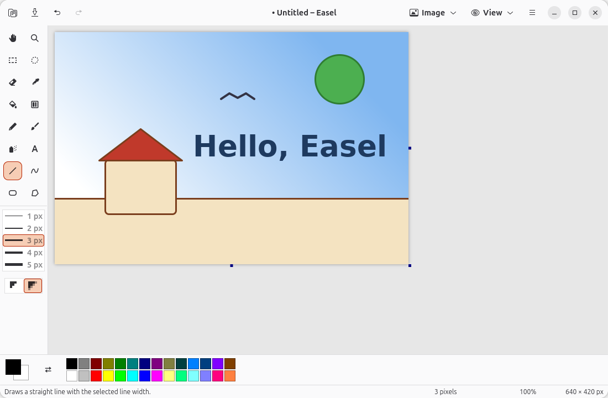

# Easel

Draw and touch up pictures. A simple, native GNOME paint program in the style of Paint in Windows XP.

Easel has the classic tools and workflow, built with GTK 4 and libadwaita, so it looks and behaves like a GNOME app: header bar, dark style, native dialogs. Pictures stay exact: hard edges and no surprise smoothing.

**Status:** 1.0.x. Free software under the GPL-3.0-or-later.

## Install
Download the latest `.deb` or Flatpak, and its `SHA256SUMS`, from the [Releases](https://github.com/jackal-kr/easel-app/releases) page. Install one of them, not both.

    sha256sum -c --ignore-missing SHA256SUMS          # check the download first
    flatpak install --user ./easel-*.flatpak          # any distribution; needs Flathub for the GNOME runtime
    sudo apt install ./easel_*_amd64.deb              # Ubuntu 26.10, x86-64

The [1.0.0 release notes](docs/release-notes-1.0.0.md) have the full steps to remove it and say where your settings are kept.

Found a bug or want a feature? Open an issue; see [CONTRIBUTING.md](CONTRIBUTING.md).

## What it does
- **Tools:** Pencil, Brush, Airbrush, Eraser, Fill, Pick Color, Magnifier, Text, Line, Curve, Shapes (19 of them, adjustable before they are put down), Polygon, Select and Free-Form Select, plus Pan and Gradient.
- **Selections:** move, copy, crop, invert, smear, transparent mode, clipboard, flip, rotate, stretch and skew.
- **Image:** Remove Background (with Keep this and Remove this brushes), Black and White, gradients (Linear, Radial, Reflected), and optional smooth edges for lines, shapes, brushes and text.
- **View:** zoom from 10 % to 1600 %, a pixel grid and a thumbnail.
- **History:** undo and redo within a memory budget you can change.
- **Files:** open and save PNG, JPEG, BMP, TIFF and WebP; open GIF; print.
- **Palette:** 28 colors, edited in place.
- **Other:** draw with the keyboard, screen-reader labels (not yet tested with Orca), a shortcuts window and a help page in 12 languages (cs, de, en, es, fr, hu, it, pl, pt, ro, ru, uk). Most translations are drafts; corrections are welcome.

## Build from source
Needs GTK 4.16 or newer, libadwaita 1.8 or newer, Meson and a C compiler. On Ubuntu 26.10:

    sudo apt install build-essential meson ninja-build gettext libgtk-4-dev libadwaita-1-dev libgdk-pixbuf-2.0-dev desktop-file-utils appstream

Then:

    meson setup build
    meson compile -C build
    ./build/src/easel
    meson test -C build --print-errorlogs

## How it is made
Easel is built spec first: every feature has a specification in `docs/specs/` and tests that check it, and the code follows from them. See [how we work](docs/how-we-work.md), the [product](docs/product.md) and [constitution](docs/constitution.md) documents, and the [feature list](docs/specs/INDEX.md). The code is written by an AI assistant (Claude) from those specs, under the instructions in [CLAUDE.md](CLAUDE.md); the owner checks each feature by using the app, not by reading every line.

## Credits and license
Inspired by Paint in Windows XP. How its classic tools behave was also studied in [JS Paint](https://github.com/1j01/jspaint) by Isaiah Odhner (MIT); no code is copied.

Not affiliated with or endorsed by Microsoft. Windows and Paint are trademarks of Microsoft.

Licensed under the GPL-3.0-or-later. See [LICENSE](LICENSE).
